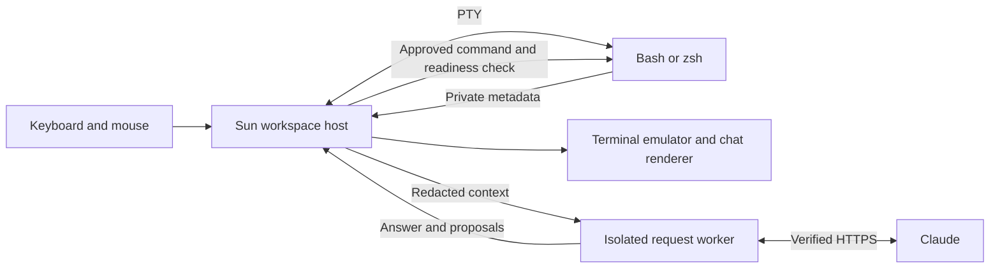

<div align="center">

# namo_complete

[](https://github.com/namo-robotics/namo_complete/actions/workflows/ci.yml) [](https://github.com/namo-robotics/namo_complete/actions/workflows/release.yml)

### A terminal assistant for zsh and Bash, written in Sun

Supports **x86_64 Linux** and **Apple Silicon macOS**

</div>


*Recorded from the real application with deterministic replies from a local API fixture.*

A regular Bash/zsh terminal beside a contextual agent. Ask about output, get
command suggestions, and keep working while the agent responds. One Sun executable;
no tmux or terminal-library dependency.

## Install

```sh
curl -fsSL https://raw.githubusercontent.com/namo-robotics/namo_complete/main/install.sh | sh
```

Add your key **before** the namo_complete source line in your shell startup file,
then open a new terminal:

```sh
export ANTHROPIC_API_KEY=sk-ant-...
```

The installer configures `~/.zshrc` on macOS or `~/.bashrc` on Linux (Bash 4.4+).
Without an API key, the terminal still works.

| Installer option | Effect |
| --- | --- |
| `--version vX.Y.Z` | Select a release; `dev` follows `main` |
| `--prefix DIR` | Install location; default `~/.local` |
| `--no-rc` | Leave shell startup files unchanged |

## Use

Installed integrations start automatically at the first interactive prompt. To
launch manually or choose a layout:

```sh
namo_complete
NAMO_LAYOUT=horizontal namo_complete  # stacked; default is side by side
NAMO_AGENT_WINDOW=0 namo_complete     # start with the agent hidden
```

Click either pane or press **Ctrl-]** to switch focus. Ask questions in the agent pane:

```text
What caused the last command to fail?
Show only the errors in this log.
Explain what this command will change.
```

- **Accept** inserts a suggestion into the shell. Edit it or press Enter to run it.
- **Cancel / Escape** dismisses a suggestion or stops a request.
- **`/run` → `/approve`** reviews and executes a proposal once, at an empty shell
  prompt in the reviewed directory. Changed shell state requires another review.
- **Hide** pauses agent requests and gives the shell the full pane.
- **×** exits namo_complete and closes its managed shell session.

Messages have separators: your text is purple, agent replies cyan, and command
suggestions yellow. Narrow windows show the focused pane at full width.

### Controls

**Ctrl-] is immediate; Alt-] is a prefix followed by another key.**

| Key / chat command | Action |
| --- | --- |
| Ctrl-] / click a pane | Switch focus |
| Alt-] then `s` | Toggle split orientation |
| Alt-] then `a` / `/hide` | Hide or reopen the agent (`/hide` only hides) |
| Alt-] then arrows | Resize the split |
| Alt-] then Page Up / Page Down | Scroll the focused pane |
| Alt-] then Ctrl-] | Send literal Ctrl-] to the shell |
| Alt-O | Insert the current hint without executing it |
| Alt-A / `/pick N` | Show alternatives / review one |
| Enter / Alt-Enter in chat | Submit / insert newline |
| Escape in chat | Cancel a request, suggestion, or approval |

## Configuration

Set variables before startup; restart to apply changes. Set `NAMO_DISABLE=1`
before sourcing the integration to use a plain shell.

| Variable | Default | Purpose |
| --- | --- | --- |
| `NAMO_DISABLE` | `0` | `1` skips automatic startup |
| `NAMO_LAYOUT` | `vertical` | Side by side; `horizontal` stacks panes |
| `NAMO_AGENT_WINDOW` | `1` | `0` starts with the agent hidden |
| `NAMO_WORKSPACE_SHELL` | `$SHELL` or `/bin/bash` | Bash/zsh executable |
| `NAMO_OUTPUT` | `10` | Positive enables output context; `0` disables it |
| `NAMO_HISTORY_LINES` | `50` | History allowance; `0` also omits captured commands |
| `NAMO_NO_LS` | `0` | `1` omits directory listings |
| `NAMO_TIMELINE_BYTES` | `8388608` | In-memory timeline limit |
| `NAMO_CONTEXT_BYTES` | `131072` | Recent context allowance per request |

Use `NAMO_MODEL`, `NAMO_TIMEOUT`, and `NAMO_DEBOUNCE` to adjust the model,
request timeout, and typing-hint delay. See [`.env.example`](.env.example).
Legacy inline and one-shot modes are removed.

## Architecture



Only the renderer writes pane content to the outer terminal. Model requests run
outside the interactive loop; stale automatic requests are canceled as you type.

| Source | Responsibility |
| --- | --- |
| [host](src/workspace/host.sun), [state](src/workspace/state.sun) | Lifecycle, event loop, resources |
| [terminal](src/workspace/terminal.sun), [tracker](src/workspace/tracker.sun) | Terminal emulation and Bash edit-buffer tracking |
| [layout](src/workspace/layout.sun), [render](src/workspace/render.sun), [chat style](src/workspace/chat_style.sun) | Pane geometry and presentation |
| [input](src/workspace/input.sun), [mouse](src/workspace/mouse.sun) | Keys, chat editing, click routing |
| [shell](src/workspace/shell.sun), [session](src/workspace/session.sun) | Shell metadata, context, approvals |
| [agent](src/workspace/agent.sun), [recovery](src/workspace/recovery.sun) | Requests, validation, worker isolation |
| [Linux](src/platform_linux.sun), [macOS](src/platform_macos.sun) | Platform system calls |

### Context and reliability

- Context includes enabled history, output, chat, directory entries, and relevant
  screen contents. Raw keystrokes are not recorded.
- A credential-prefix filter runs before requests and summaries. It is heuristic,
  not comprehensive secret detection.
- Transcripts stay in memory. Older context is summarized or visibly truncated;
  temporary shell-control files are removed on normal exit.
- Replies appear when complete. No token streaming or persistent transcript cache.
- Missing credentials and request failures leave the shell usable. Internal agent
  errors hide its pane; reopen it to retry.
- Startup failure or host crashes return to the launching shell where possible.
  Commands and unsaved state in the managed shell may be lost.
- Graphics and clipboard escape sequences are not forwarded to the outer terminal.

## Development

Use the [development container](.devcontainer/) or install the build dependencies:

- **Linux:** `x86_64-linux-musl-gcc` with musl-built C++ runtime archives from musl.cc.
- **macOS:** `brew install llvm@20 libarchive bash` and a recent Apple linker.

```sh
./upgrade-sun.sh         # matching compiler and libraries in .sun/
./build.sh              # bin/namo_complete
cp .env.example .env && chmod 600 .env
./run.sh                # local run; reads .env

./test.sh               # CLI and packaging
./test-zsh.sh           # macOS installer checks
python3 test-terminal.py # metadata backpressure
./test-workspace.sh     # emulator, Bash/zsh PTYs, local API tests
```

CI shares [toolchain setup](tools/setup-ci.sh) and [linkage checks](tools/check-linkage.sh):
Linux binaries are fully static; macOS binaries use only Apple system libraries.
OpenSSL is linked into both. macOS CI uses a macOS 26 runner and a macOS 15 deployment target.
See [Sun compiler notes](SUN_FEEDBACK.md) for remaining toolchain limitations.

To refresh the demo, install Pillow and pyte in a Python environment, then run:

```sh
python3 tools/record-demo.py --font /path/to/monospace.ttf
```

The recording uses a local API fixture; no API key is needed.

## Uninstall

```sh
rm -f ~/.local/bin/namo_complete
rm -rf ~/.local/share/namo_complete ~/.cache/namo_complete
for rc in ~/.zshrc ~/.bashrc; do
  [ -f "$rc" ] && sed -i.bak "/# namo_complete/,+1d" "$rc" && rm -f "$rc.bak"
done
```

[MIT License](LICENSE)
