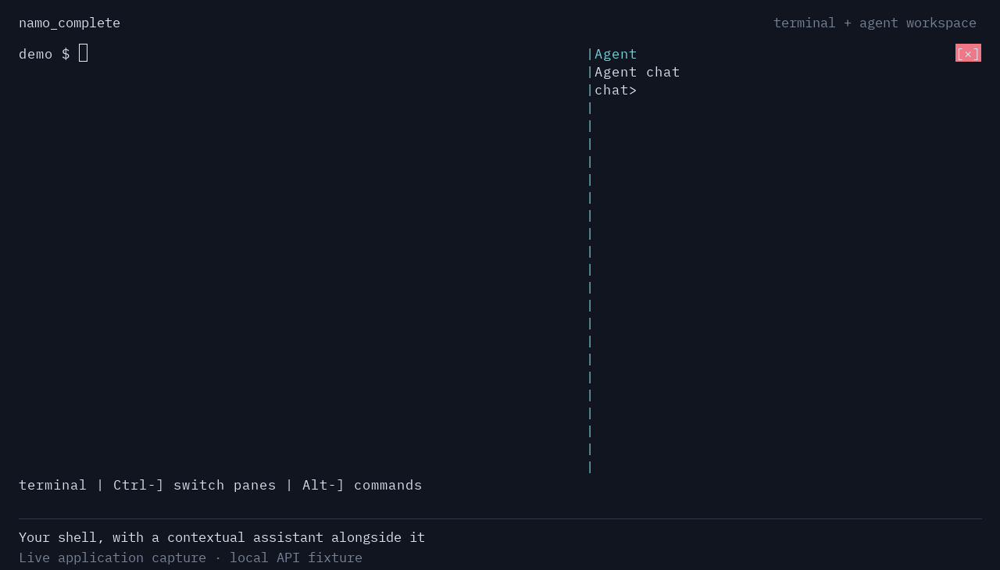
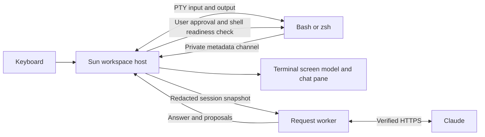

<div align="center">

# namo_complete

[](https://github.com/namo-robotics/namo_complete/actions/workflows/ci.yml) [](https://github.com/namo-robotics/namo_complete/actions/workflows/release.yml)

### A terminal assistant for zsh and Bash, written in Sun

Supports **x86_64 Linux** and **Apple Silicon macOS**

</div>



*Recorded from the real application with deterministic replies from a local API fixture.*

## Terminal and agent workspace

The built-in workspace puts your shell on the left and an agent conversation on
the right. It hosts a real shell PTY and renders its screen in Sun, with no tmux
or terminal-emulation library dependency. Chat requests run in a separate process,
so the shell stays responsive while the agent answers.

Start the workspace:

```sh
namo_complete
```

Installed Bash and zsh integrations start the workspace at the first interactive
prompt. The inline hint-only interface has been removed; `NAMO_UI=legacy` no
longer selects it. Set `NAMO_DISABLE=1` before sourcing the integration for a
regular shell. Existing installations need the updated binary and shell files.

Choose an orientation before launching:

```sh
export NAMO_LAYOUT=vertical   # side by side: terminal left, agent right (default)
export NAMO_LAYOUT=horizontal # stacked: terminal above, agent below
```

Press **Alt-] then s** to switch orientation without restarting the shell.
Click inside either pane to focus it. The chat prompt and draft stay inside the
agent pane, immediately below the latest conversation output. It starts near
the top and scrolls naturally as the conversation grows, even while you work in
the terminal. Click that prompt and type to
ask a question; no Alt-G shortcut is needed. Terminal programs that request mouse input
continue receiving clicks inside the terminal pane. Hold Shift while selecting
text if your terminal uses that modifier to bypass application mouse reporting.

| Key or chat command | Action |
| --- | --- |
| Alt-] then a | Hide or reopen the agent pane |
| `/hide` in chat | Hide the agent pane |
| Ctrl-] | Switch panes immediately |
| Alt-] then s | Switch between vertical and horizontal layouts |
| Click a pane | Focus that pane |
| × at the top-right of the agent pane | Exit namo_complete and close its shell session |
| Accept / Cancel buttons | Insert a suggestion into the terminal edit buffer or dismiss it |
| Run button after review | Approve the displayed command once |
| Alt-] then arrows | Resize the split (Left/Up shrinks the terminal; Right/Down grows it) |
| Alt-] then Page Up / Page Down | Scroll the focused pane |
| Alt-] then Ctrl-] | Send a literal Ctrl-] to the shell |
| Alt-O | Insert the current hint into the shell's editable line |
| Alt-A | Show command alternatives in chat |
| Enter in chat | Submit a question |
| Alt-Enter in chat | Insert a newline |
| Left / Right, Home / End in chat | Move the editing cursor |
| Escape in chat | Stop a request and dismiss the current suggestion or approval |
| `/pick N` in chat | Select and review a numbered alternative |
| `/run` in chat | Review the proposed command and its working directory |
| `/approve` in chat | Approve that reviewed command once |

**Ctrl-] switches panes immediately.** Use **Alt-]** as the prefix for layout,
visibility, resizing, and scrolling commands. Escape cancels the prefix.

Hide the agent pane with **Alt-] then a** to give the terminal the full width.
While hidden, pending requests and approvals are canceled and new agent requests
are paused. Chat and local session context remain in memory for reopening. Commands
already running in the shell continue. Set `export NAMO_AGENT_WINDOW=0` before
starting the workspace to begin with the agent hidden; Alt-] then `a` reopens it.

The split starts at 60% terminal and 40% chat. When there is too little width
for a vertical split or too little height for a horizontal split, the focused
pane fills the workspace. The shell retains its own editing, functions, environment, job control,
colors, and full-screen applications. The workspace reserves its documented keys.
ANSI cursor movement, scrolling regions, alternate screens, common Unicode widths,
colors, terminal queries, bracketed paste, and application mouse reporting are
handled by the built-in screen model. Graphics and clipboard escape protocols are
not passed through to the outer terminal.

Chat turns have separators: user messages are purple, agent replies cyan, and
command suggestions yellow. Accept is green; Cancel and close are red.

Typing suggestions replace a single hint instead of filling the conversation.
The agent can return no suggestion when none is useful. Escape in chat or Cancel
dismisses the suggestion until the shell changes. Outdated automatic requests
stop when you resume typing; intentional interruptions do not trigger advice.
Failed commands can trigger an explanation. The assistant can also propose a
command in response to a question. A proposal does nothing until you review it
and explicitly approve it. The managed shell must still be at an empty primary
prompt in the reviewed directory. Changed state requires another review; subsequent
commands need their own approvals. Alt-O only inserts text and never runs it.

Workspace source files are organized by responsibility:

| File | Responsibility |
| --- | --- |
| [`workspace/host.sun`](src/workspace/host.sun) | Startup, event loop, and shutdown |
| [`workspace/state.sun`](src/workspace/state.sun) | Shared state and resource ownership |
| [`workspace/layout.sun`](src/workspace/layout.sun) | Shared pane geometry for rendering, resizing, and mouse routing |
| [`workspace/tracker.sun`](src/workspace/tracker.sun) | Bash edit-buffer tracking from displayed output |
| [`workspace/render.sun`](src/workspace/render.sun) | Pane rendering and visibility |
| [`workspace/chat_style.sun`](src/workspace/chat_style.sun) | Chat and command section colors |
| [`workspace/input.sun`](src/workspace/input.sun) | Key decoding, focus, and chat editing |
| [`workspace/mouse.sun`](src/workspace/mouse.sun) | Click focus and terminal application mouse forwarding |
| [`workspace/shell.sun`](src/workspace/shell.sun) | Trusted shell metadata and guarded command submission |
| [`workspace/session.sun`](src/workspace/session.sun) | Context, request lifecycle, and proposal approval |
| [`workspace/recovery.sun`](src/workspace/recovery.sun) | Nonblocking worker transfer, reaping, and agent failure isolation |
| [`workspace/agent.sun`](src/workspace/agent.sun) | Model transport, redaction, and response validation |
| [`workspace/terminal.sun`](src/workspace/terminal.sun) | Terminal screen model and escape parsing |

The event loop coordinates these modules. Shell metadata stays separate from
terminal output, and only the renderer writes pane content to the outer terminal.
Platform-specific system calls remain in the platform modules.

The workspace owns the terminal; model work runs in an isolated worker:



### Workspace context and privacy

The agent receives shell metadata, enabled recent history, command output,
conversation turns, and a snapshot of full-screen applications when relevant.
Command output is captured separately from echoed command input. Raw keystrokes
are not recorded; password input without terminal echo is not captured. The existing
credential-prefix filter is applied before requests and summaries, including chat
input. It is a heuristic, not comprehensive secret detection.

The session timeline is bounded in memory. Older context is summarized asynchronously;
if summarization fails or capture exceeds its limit, requests use marked truncation.
The status row indicates summarized or omitted context. Transcript data is not
saved across restarts. Private temporary files hold shell bootstrap scripts and a
pending command for the guarded shell widget; they are removed when the workspace
exits normally. The API key remains in process memory and the verified TLS connection.

| Workspace setting | Default | Meaning |
| --- | --- | --- |
| `NAMO_DISABLE` | `0` | Set to `1` before sourcing integration to use a plain shell |
| `NAMO_LAYOUT` | `vertical` | `vertical` places panes side by side; `horizontal` stacks them |
| `NAMO_WORKSPACE_SHELL` | `$SHELL`, otherwise `/bin/bash` | Bash or zsh executable |
| `NAMO_TIMELINE_BYTES` | `8388608` | Maximum retained session transcript bytes |
| `NAMO_CONTEXT_BYTES` | `131072` | Recent transcript allowance per request |
| `NAMO_AGENT_WINDOW` | `1` | Set to `0` to start the workspace with the agent pane hidden |
| `NAMO_OUTPUT` | `10` | Any positive value enables workspace output context; zero disables it |
| `NAMO_HISTORY_LINES` | `50` | Initial history allowance; zero also omits recorded commands |
| `NAMO_NO_LS` | `0` | Set to `1` to omit directory entries |

`ANTHROPIC_API_KEY`, `NAMO_MODEL`, `NAMO_TIMEOUT`, and `NAMO_DEBOUNCE` configure
the provider, model, request timeout, and typing-hint delay. Restart the workspace
after changing environment settings.
Conversations and contextual hints are not cached.
Replies appear when complete; token streaming and persistent session transcripts
are not included. A missing API key or failed request leaves the shell usable.
Worker input is sent incrementally, directory listing runs in the worker, and
worker completion and cancellation do not wait on the interactive thread. Workspace
request timeouts are bounded between one second and five minutes. Internal agent
errors hide the pane; Alt-] then `a` reopens it to retry.

Automatic startup keeps the original shell available until the managed shell
exits normally. If startup fails or the workspace host crashes, the integration
restores terminal settings and returns to that original shell without retrying.
Commands and unsaved state inside a crashed managed shell may be lost. This cannot
recover from a terminated terminal app or operating-system failure. Set
`NAMO_DISABLE=1` before sourcing the integration to bypass it entirely.

## Install

```sh
curl -fsSL https://raw.githubusercontent.com/namo-robotics/namo_complete/main/install.sh | sh
```

macOS uses its built-in zsh and updates `~/.zshrc`; no Homebrew shell is
required. Linux uses Bash 4.4 or newer and updates `~/.bashrc`.

Set `ANTHROPIC_API_KEY` in your shell startup file **before** the namo_complete
source line, then open a new terminal:

```sh
export ANTHROPIC_API_KEY=sk-ant-...
```

The terminal works without an API key; only agent requests are disabled.

The installer selects the Linux x86_64 or macOS arm64 release artifact,
installs the binary plus both shell integrations, and sources the platform
default: zsh on macOS, Bash on Linux.

Options:

| Option             | Env var        | Effect                                                                                                                  |
| ------------------ | -------------- | ----------------------------------------------------------------------------------------------------------------------- |
| `--version vX.Y.Z` | `NAMO_VERSION` | Install a particular release; `dev` takes the latest build of `main`. Default: latest stable, or `dev` if there is none |
| `--prefix DIR`     | `NAMO_PREFIX`  | Install root. Default `~/.local`                                                                                        |
| `--no-rc`          | —              | Skip the `.zshrc` or `.bashrc` edit; add the source line yourself                                                  |


## Uninstall

```sh
rm -f ~/.local/bin/namo_complete
rm -rf ~/.local/share/namo_complete ~/.cache/namo_complete
for rc in ~/.zshrc ~/.bashrc; do
  [ -f "$rc" ] && sed -i.bak "/# namo_complete/,+1d" "$rc" && rm -f "$rc.bak"
done
```
## Development

To refresh the README animation, build the binary, install `Pillow` and `pyte` in a
Python environment, then run `python3 tools/record-demo.py --font /path/to/monospace.ttf`.
The recording uses a temporary shell session and local API fixture; no API key is needed.

```sh
./run.sh            # try it here, without installing anything
./upgrade-sun.sh    # install the latest matching Sun compiler and libraries locally
./build.sh          # -> bin/namo_complete
./test.sh           # workspace-only CLI and packaging checks
./test-zsh.sh       # macOS installer regressions
python3 test-terminal.py # workspace metadata backpressure regressions
./test-workspace.sh # screen model, real PTYs, and local API approval tests
```

`run.sh` reads `.env`, which is never committed:

```sh
cp .env.example .env && chmod 600 .env
```

[`.devcontainer/`](.devcontainer/) uses the repository's Ubuntu 26.04
image. The validated compiler is Sun `cc7686189ee2`. Builds require a complete
Sun dev artifact with matching `stdlib.moon` and `tls.moon` bundles.
`upgrade-sun.sh` installs these into `.sun/`, which `build.sh` uses automatically.
The current macOS TLS bundle requires a recent Apple linker; CI uses the
macOS 26 toolchain with a macOS 15 deployment target (see `SUN_FEEDBACK.md`).

## Notes on Sun

[SUN_FEEDBACK.md](SUN_FEEDBACK.md) tracks the remaining compiler and standard-library
gaps, including the remaining platform FFI and borrow workarounds.

## License

See [LICENSE](LICENSE).
